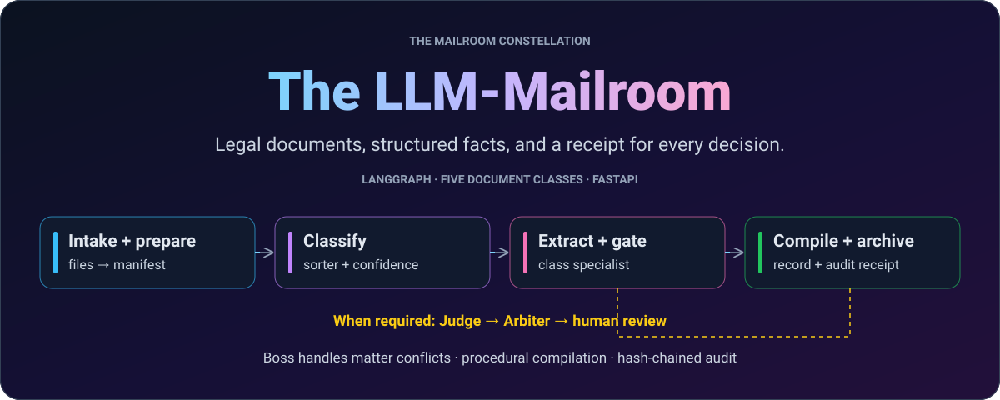
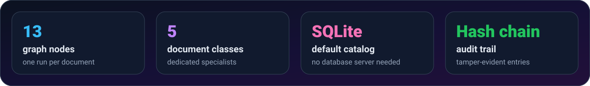
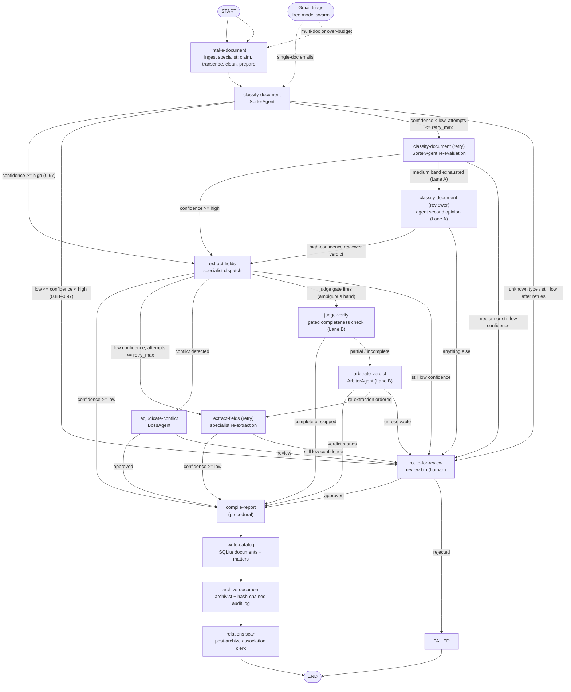
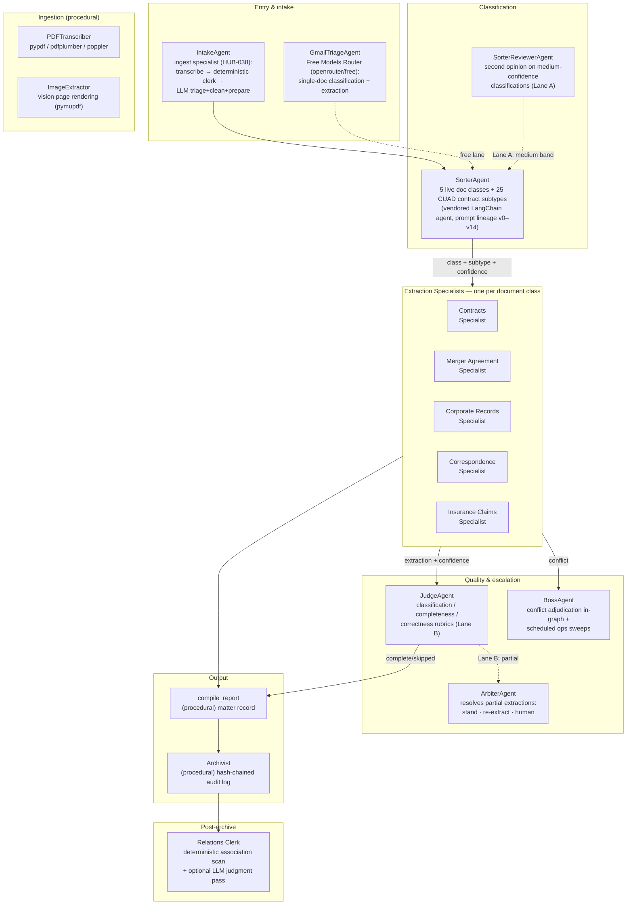

<div align="center">

<picture>
  <source media="(max-width: 640px)" srcset="docs/assets/readme/hero-mobile.svg"/>
  
</picture>

<br/>

[](pyproject.toml)
[](src/graph/build_graph.py)
[](docs/pipeline-reference-llm-mailroom/configuration.md)
[](#api-endpoints)

[](https://github.com/Exios66/llm-mailroom/releases/tag/v0.8.1)
[](https://github.com/Exios66/llm-dojo-scoring/releases/tag/v0.24.1)
[](https://github.com/LLM-Mailroom-Services/Digital-Mailroom)
[](https://huggingface.co/spaces/Lucius-Morningstar/mailroom-observatory)
[](https://github.com/Exios66/llm-mailroom/wiki)

**[Quickstart](#quickstart)** · **[How it works](#how-it-works)** · **[Operations](#operations)** · **[Testing](#testing)** · **[Where it fits](#where-it-fits)** · **[Docs](#documentation)**

</div>

---

<!-- readme-v2.1 -->
<details>
<summary><b>📑 Contents</b></summary>

- [📬 What is this?](#what-this-does)
- [🤔 When to reach for it](#when-to-reach-for-it)
- [🏭 One document, start to receipt](#-one-document-start-to-receipt)
- [📟 At a glance](#at-a-glance)
- [🌌 Where it fits](#where-it-fits)
- [🚀 Quickstart](#quickstart)
- [🧭 How it works](#how-it-works)
- [🧱 Design principles](#design-principles)
- [🗂️ Project structure](#project-structure)
- [🛠️ Operations](#operations)
- [🔬 Evaluation & ecosystem](#evaluation--ecosystem)
- [📚 Documentation](#documentation)
- [❓ FAQ](#faq)
- [🙏 Built on](#built-on)
- [🤝 Contributing, security and license](#contributing-security-and-license)

</details>

<a id="what-this-does"></a>

## 📬 What is this?

Every legal document that lands in a transactional practice needs the same
four things: someone to **sort** it, someone to **read** it, someone to
**check the work**, and a **receipt** proving it all happened. The
LLM-Mailroom is that whole shift, staffed by agents. It is a **LangGraph
pipeline for legal documents**: ingest a file, classify it, extract
structured facts with the matching specialist, apply quality gates, and compile
an auditable matter record. FastAPI accepts uploads, and the embedded watcher
moves each file through the processing, review, archive or failure bins.

Five classes have dedicated schemas and specialists: `contract`,
`merger_agreement`, `corporate_record`, `correspondence` and
`insurance_claim`. MAUD merger agreements have their own specialist. The
high-confidence happy path uses two LLM generations (classification and
extraction). Judge, Arbiter, Boss and human review handle the documents that
need more scrutiny, and compilation is procedural, with no LLM call.

This standalone repository owns the pipeline source. The
[Digital-Mailroom hub](https://github.com/LLM-Mailroom-Services/Digital-Mailroom)
imports committed revisions, the [sandbox](https://github.com/Exios66/local-mailroom-sandbox)
executes it, [Dojo](https://github.com/Exios66/llm-dojo-scoring) scores it,
and [The-Mailroom](https://github.com/Exios66/The-Mailroom) visualizes its
Langfuse traces. The latest published pipeline release is
[`v0.8.1`](https://github.com/Exios66/llm-mailroom/releases/tag/v0.8.1). The
dependency badge reflects this checkout's Dojo pin, **v0.24.1**.

<details>
<summary><b>Meet Fumi and Hermes — the original mailroom artwork</b></summary>


Fumi (文, “letter”) is the mailroom's head maid. See the [static landing](landing/)
and [documentation home](docs/README.md).

</details>


<div align="center">
<picture>
  <source media="(max-width: 640px)" srcset="docs/assets/readme/stats-mobile.svg"/>
  
</picture>
</div>

<a id="when-to-reach-for-it"></a>

## 🤔 When to reach for it

| ✅ Reach for it when… | ↪️ Look elsewhere when… |
| :--- | :--- |
| You need legal documents sorted into five classes and turned into validated, structured matter records | You want a free-form chat agent. Orchestration here is an explicit 13-node state machine, and agents do not negotiate |
| Every decision must be auditable: a trace per document and a SHA-256 hash-chained audit trail per archive | Your documents fall outside the five classes. Court opinions and due-diligence memos classify as `unknown` and go to human review |
| You want to run on OpenRouter today and move agents to local models later with a config change | You only need scoring or a viewer. Use [llm-dojo-scoring](https://github.com/Exios66/llm-dojo-scoring) or [The-Mailroom](https://github.com/Exios66/The-Mailroom) on their own |

## 🏭 One document, start to receipt

<div align="center">
<picture>
  <source media="(max-width: 640px)" srcset="docs/assets/readme/flow-mobile.svg"/>
  
</picture>
</div>

<br/>

| | Phase | Graph node(s) | What happens |
| :---: | :--- | :--- | :--- |
| 📥 | **Intake** | `intake-document` | The ingest specialist claims the file, transcribes it, cleans it and writes its manifest |
| 🏷️ | **Classify** | `classify-document`, `(retry)`, `(reviewer)` | `SorterAgent` picks one of the five classes with a confidence score. High confidence goes to extraction, medium confidence gets a retry and a reviewer's second opinion, and low or unknown confidence goes to a human |
| 🔍 | **Extract** | `extract-fields`, `(retry)` | The class specialist fills a Pydantic schema, gated on schema validity, confidence, factuality and completeness |
| ⚖️ | **Quality** | `judge-verify`, `arbitrate-verdict`, `adjudicate-conflict` | The Judge checks ambiguous completeness. The Arbiter lets the verdict stand, orders a re-extraction or escalates. The Boss adjudicates matter conflicts |
| 🧑‍⚖️ | **Human review** | `route-for-review` | The governance boundary: a person approves, rejects or requeues. A rejection ends in `FAILED` |
| 🗂️ | **Compile → Catalog → Archive** | `compile-report`, `write-catalog`, `archive-document` | Procedural matter-record assembly, SQLite persistence, and a SHA-256 hash-chained audit archive |

That is **13 nodes** in all. Two auxiliary flows run outside the graph: the
Gmail triage lane and the post-archive relations clerk (details below).

<a id="at-a-glance"></a>

## 📟 At a glance

<div align="center">

</div>

<a id="where-it-fits"></a>

## 🌌 Where it fits

<div align="center">
<picture>
  <source media="(max-width: 640px)" srcset="docs/assets/readme/constellation-mobile.svg"/>
  
</picture>
</div>

| | Neighbour | Relationship |
| :---: | :--- | :--- |
| 🏛️ | [`Digital-Mailroom`](https://github.com/LLM-Mailroom-Services/Digital-Mailroom) | The integration hub. It imports this repository into `packages/llm-mailroom`; changes are authored here first |
| 🧪 | [`local-mailroom-sandbox`](https://github.com/Exios66/local-mailroom-sandbox) | Executes the pipeline offline or on Modal/vLLM GPUs |
| 🥋 | [`llm-dojo-scoring`](https://github.com/Exios66/llm-dojo-scoring) | Scores every run; the pipeline pins a Dojo release |
| 👾 | [`The-Mailroom`](https://github.com/Exios66/The-Mailroom) | Visualizes the pipeline's Langfuse traces, and its Observatory floor talks to this API |
| 📊 | [`Mailroom-Corpus-EDA`](https://github.com/Exios66/Mailroom-Corpus-EDA) | Publishes the `mailroom-dataset` corpus the evals pull |
| 🧠 | [`mailroom-ml`](https://github.com/LLM-Mailroom-Services/mailroom-ml) | Standalone contractor: the optional ModernBERT intake fast path (`[bert]` extra) |

<a id="quickstart"></a>
<a id="getting-started"></a>
<a id="quick-start"></a>

## 🚀 Quickstart

<div align="center">

</div>

> [!NOTE]
> **No database server needed.** Catalog and audit entries use SQLite in your data folder. Graph checkpoints use in-memory `MemorySaver` by default; opt into persistent checkpoints with `MAILROOM_CHECKPOINTER=sqlite`. Docker is optional.

Use Python 3.11+ and a dedicated virtual environment:

```bash
git clone https://github.com/Exios66/llm-mailroom.git
cd llm-mailroom
python3 -m venv .venv
source .venv/bin/activate
python -m pip install -e ".[dev]"
cp .env.example .env
# Add OPENROUTER_API_KEY to .env for live inference.
```

Start the API; its embedded watcher drains uploads:

```bash
PYTHONPATH=src python -m api.main
```

In a second terminal at the repository root, submit the committed test fixture:

```bash
curl -X POST http://localhost:8000/upload \
  -F "file=@src/tests/fixtures/contract/sample_msa.txt" \
  -F "matter_id=MATTER-001"
# Use the returned doc_id in these URLs:
curl http://localhost:8000/status/YOUR_DOC_ID
curl http://localhost:8000/audit/YOUR_DOC_ID
```

The fixture exercises the live pipeline; it is not an accuracy benchmark.
For an offline first check, run `python -m pytest src/tests/test_routing.py`.
Langfuse and the other tracing backends are optional; setup is in
[Observability](#observability).

Runtime state is stored under `data/` (or `MAILROOM_BASE_DIR`):

- `data/mailroom.db` — the SQLite database (matters, documents, audit_log tables)
- `data/checkpoints.db` — optional on-disk LangGraph state (only when `MAILROOM_CHECKPOINTER=sqlite`; MemorySaver is the default)

### Installation

<a id="installing"></a>
Core install (pipeline + API + tests):

```bash
pip install -e ".[dev]"
```

Optional install profiles — take only what you need:

| Extra | Adds | Used by |
| --- | --- | --- |
| `[embeddings]` | scipy, sentence-transformers | embedding-rescue second signal + Hungarian matcher in field scoring (degrades gracefully without) |
| `[postgres]` | psycopg | Postgres storage engine (SQLite is the default) |
| `[deploy]` | modal | the Modal+vLLM deploy app in `deploy/` (deploy-time only, never imported by the pipeline) |
| `[bert]` | mailroom-ml inference dependencies | optional ModernBERT intake classifier |
| `[notebooks]` | ipywidgets, jupyterlab | interactive `notebooks/dataset_browser.ipynb` (plain-text mode works without) |

```bash
pip install -e ".[embeddings]"   # etc.
```

> **In the monorepo** ([`Digital-Mailroom`](https://github.com/LLM-Mailroom-Services/Digital-Mailroom)):
> this repo is `packages/llm-mailroom` via git subtree. Skip `pip install` —
> `uv sync` at the monorepo root installs every workspace member (this package
> editable) from one `uv.lock`. Release/deploy images still `pip install .`
> from this (or the subtree) directory, where the published pins in
> `pyproject.toml` keep their standalone meaning (see
> [`docs/pipeline-reference-llm-mailroom/sister-repos.md`](docs/pipeline-reference-llm-mailroom/sister-repos.md)).

---

<a id="how-it-works"></a>

## 🧭 How it works

<a id="architecture"></a>

One **LangGraph state machine run per document** — 13 nodes, MemorySaver-checkpointed by default (opt-in `SqliteSaver` for resume-across-restart experiments), crash-safe via manifest-driven re-invocation. Files move through filesystem bins (`inbox → processing → archive | review | failed`); every decision is a named node with a deterministic trace in the configured observability backend.

### LangGraph state machine

The core pipeline is a **13-node LangGraph state machine** executed once per document. Two auxiliary flows operate outside the graph: the **Gmail triage lane** (free model swarm for single-document emails) and the **relations clerk** (post-archive association scanning).

<details>
<summary><b>🗺️ The full 13-node state machine (Mermaid)</b></summary>



</details>

Thresholds (`confidence.low`, `confidence.high`, `retry_max`) are config in `config/taxonomy.yaml`, never hardcoded.

**Auxiliary flows (outside the 13-node graph):**

- **Gmail triage lane** (`agents/gmail_triage.py`): the free OpenRouter lane runs on the Free Models Router (`openrouter/free` — auto-selects the best free model per request) handling single-document Gmail uploads through classification + key extraction + auditable-hash archive without calling paid agents. Multi-document emails and documents exceeding the free budget route to the full pipeline.
- **Relations clerk** (`pipeline/relations.py`): post-archive deterministic association scanning (same-matter, keyword Jaccard, party overlap, embedding cosine) with an optional LLM judgment pass for ambiguous near-misses. Dispatched off the document path at every terminal manifest.

### Agent Organization

The agent roster as declared in `config/taxonomy.yaml` — every LLM agent resolves its provider/model/prompt through `get_llm(agent_name)`; nothing is hardcoded:

<details>
<summary><b>🧑‍💼 The agent roster (Mermaid)</b></summary>



</details>

Document classes (5): `contract`, `corporate_record`, `correspondence`, `merger_agreement`, `insurance_claim` — each with its own extraction schema and specialist. Court opinions and due-diligence memos classify as `unknown` (human review), not as a nearby class. The compliance class was removed from `taxonomy.yaml` on 2026-09-15 (commit `59c47401`) — the five-class roster plus `unknown` is final. The two vendored agents (Sorter, Contracts Specialist) come from the sister repo [llm-entity-extraction](https://github.com/Exios66/llm-entity-extraction) with their full append-only prompt lineage; all other agents are mailroom-native `BaseAgent` subclasses with Langfuse-managed prompts.

<a id="design-principles"></a>

## 🧱 Design principles

1. **Auditability over cleverness.** Every classification, extraction, and routing decision is traceable (Langfuse trace per document, hash-chained audit log per archive).
2. **Explicit over emergent.** Orchestration is a defined state machine — agents don't freely negotiate.
3. **Human-legible state.** Filesystem bins let anyone `ls` a folder and understand where a document is.
4. **Provider-agnostic LLM layer.** OpenRouter today, local models later — one config change.
5. **Redundant record-keeping.** Audit trail doesn't depend on any single tool staying alive.
6. **Config over code.** Taxonomy, thresholds, model mappings, retry tuning, and per-agent token caps all live in `config/taxonomy.yaml`.

<a id="project-structure"></a>

## 🗂️ Project structure

The repository root holds only the essentials — `src/` (all code), `data/`
(runtime state), `docs/` (documentation + reference material), plus the
tooling files. Everything else is nested:

<details>
<summary><b>The directory tree</b></summary>

```
mailroom/
├── src/             # ALL Python code
│   ├── agents/          # Specialist agents (Sorter, Contract, Corp Records, Judge, …)
│   ├── langchain_agents/# Vendored LangChain agents (Sorter, Contracts Specialist) originally from llm-entity-extraction (now standalone)
│   ├── graph/           # LangGraph state machine: nodes, routing, state
│   ├── llm/             # Provider-agnostic LLM client, retry, Langfuse-managed prompts
│   ├── schemas/         # Pydantic models: manifest, matter, documents, audit
│   ├── pipeline/        # Watcher, filesystem bins, ops monitor
│   ├── storage/         # SQLite/Postgres: catalog CRUD, audit log
│   ├── api/             # FastAPI: upload, review, status, audit
│   ├── observability/   # Langfuse tracing + task-spec scores + deterministic field scoring
│   ├── config/          # taxonomy.yaml — doc classes, thresholds, model mappings
│   │   └── docker/      # docker-compose: Langfuse, Ollama (Postgres optional)
│   ├── legalbench/      # LegalBench evaluation suite (binary QA + family classification)
│   ├── scripts/         # ops & eval: run_pilot, run_quality_judges, run_vision_sweep, sync_*, cutover, compare_runs, fetch_full_cuad, validate_pipeline
│   └── tests/           # pytest: unit, routing, e2e, judge, fixtures
├── notebooks/        # docile-style dataset browser (thin notebook + tool module)
├── deploy/           # Modal+vLLM serving app (optional local-model cutover)
├── data/             # runtime state: inbox/processing/archive bins, mailroom.db, cuad/ corpus, manifests/
└── docs/             # canonical docs (pipeline reference under pipeline-reference-llm-mailroom/: agents, architecture, configuration, deployment, local-models)
    ├── assets/       # README banner + images
    ├── reports/      # evaluation write-ups: audits/, pilots/, evaluations/ (see docs/reports/)
    └── wiki/         # GitHub-wiki-only pages, pushed to the GitHub wiki via docs/wiki/sync-wiki.sh (NOT a docs/ mirror)
```

All code runs with `src/` on the import path (`PYTHONPATH=src`), so intra-repo
imports keep their plain package names (`from pipeline import …`).

</details>

---

<a id="operations"></a>

## 🛠️ Operations

<details>
<summary><b>Configuration, providers, prompts, scoring, guardrails and API reference</b></summary>


### Configuration

All config lives in `config/taxonomy.yaml` — **never hardcoded**.

> [!IMPORTANT]
> `taxonomy.yaml` is cached at import time (`lru_cache` in `pipeline/config.py`, module-level cache in `pipeline/bins.py`) — **restart the watcher/API after editing it**; changes are not picked up live.

<details>
<summary>Config cookbook — doc classes, thresholds, retries, per-agent caps</summary>

```yaml
# Add a doc class:
doc_classes:
  - key: new_doc_type
    label: "New Document Type"
    schema: NewExtractionSchema
    specialist: new_specialist

# Adjust thresholds:
confidence:
  high: 0.97       # global fallback; per-class by_class overrides after type known
  low: 0.88        # below this → retry → still low → human review
  retry_max: 2     # max classify/extract retries before routing to review
  arbiter_retry_max: 2
  judge_max_passes: 3  # 1 + arbiter_retry_max

# Transient-failure LLM retries (connection errors, 429, 5xx):
llm_retry:
  max_attempts: 5
  base_delay: 1.0
  rate_limit_base_delay: 8.0
  max_delay: 60.0
  jitter: 0.3

# PDF transcription: skip the LLM reformat pass for text-based PDFs whose
# extraction yields at least this many chars/page (scanned PDFs still go to LLM):
pipeline:
  pdf_direct_chars_per_page: 800

# Per-agent model mapping + output token caps (caps runaway reasoning output):
agents:
  sorter:
    provider: openrouter
    model: qwen/qwen3.7-flash
    temperature: 0.1
    max_tokens: 2048
```

</details>

### LLM Providers

| Provider | Status | Auth | Base URL |
| --- | --- | --- | --- |
| **OpenRouter** | Primary | `OPENROUTER_API_KEY` | `https://openrouter.ai/api/v1` |
| **Ollama** | Local | None | `http://localhost:11434/v1` |
| **vLLM** | Local/Modal | `VLLM_API_KEY` (optional bearer) | `http://localhost:8000/v1` (or `VLLM_BASE_URL`) |
| **Generic** | Fallback | `GENERIC_API_KEY` | Configurable |

Global override: set `DEFAULT_PROVIDER=ollama` in `.env`.

With `DEFAULT_PROVIDER=vllm`, agent model slugs are remapped to the served HF
ids via `taxonomy.yaml: vllm_model_map`; a missing `VLLM_BASE_URL` warns
(localhost default). Self-hosted providers (`vllm`/`ollama`/`generic`) are
exempt from `MAILROOM_LLM_FREE_ONLY` — it bounds OpenRouter spend (DMR-052).

All LLM calls go through `retry_chat_completion` (`llm/retry.py`): transient failures (`APIConnectionError`, timeouts, rate limits, 5xx) are retried with exponential backoff + jitter; 4xx client errors (e.g. malformed requests) are never retried. A `503` from a `*.modal.run` endpoint is treated as a scale-to-zero cold start and uses a long bounded backoff (90s base / 240s cap) so the ladder survives container warm-up (DMR-052).

### Prompt Management

Every agent's system prompt is a **Langfuse-managed prompt** (`mailroom-<agent_name>`, type `text`, `production` label) — versioned, editable without a deploy, and linked to every generation in the trace UI.

```bash
# Push the local prompt templates to Langfuse (idempotent: only new versions on change)
PYTHONPATH=src python src/scripts/sync_prompts.py
PYTHONPATH=src python src/scripts/sync_prompts.py --dry-run   # preview
PYTHONPATH=src python src/scripts/sync_prompts.py --agent sorter
```

The code ships the same templates as fallbacks (`llm/prompts.py`): if Langfuse is disabled or unreachable, the pipeline runs identically on the local defaults. The `json_object` response-format boilerplate stays hardcoded — some providers require the literal token `json` in the messages.

Vendored LangChain prompt *history* stays in `PROMPT_VERSIONS` (`sorter_v0…v14`, `contracts_specialist_v1…v33`) so eval loops can pin one version per experiment. Production is different: **sorter_v14** for classify, and sandbox / eval-environment **frozen v1** stems for every extract specialist (`llm/frozen_v1/`, `_bound_prompt_versions`). Mailroom wrappers resolve both through `get_managed_prompt` (`mailroom-<agent>`, `production` label) so LangGraph classify/extract nodes share the Langfuse surface.

### Observability

- **Tracing** — every LLM call (prompt, response, tokens, latency) is auto-logged to **Langfuse** (cloud or self-hosted) or **Braintrust**, selected via `OBSERVABILITY_PROVIDER` in `.env`. One trace per document, one span per node, `session_id = matter_id` (or a run-scoped session for pilot runs), deterministic trace ids seeded from filenames. Optional — the pipeline runs fine with tracing disabled.
- **Scores** — every run emits self-evident scores (`parse_error`, `schema_valid`, `stage_completed`, `success_rate` first-pass STP, confidence values); pilot runs add ground-truth scores (`class_correct`, `stage_correct`, calibration error). Score configs are auto-created by `observability/scores.py` (`ensure_score_configs()`).
- **Run-log mirroring** — pull traces (with observations + scores) into the repo for offline analysis by subagents:

```bash
PYTHONPATH=src python src/scripts/sync_langfuse_logs.py                    # last 24h
PYTHONPATH=src python src/scripts/sync_langfuse_logs.py --since 7d --limit 100
PYTHONPATH=src python src/scripts/sync_langfuse_logs.py --trace-id YOUR_TRACE_ID
# → data/langfuse_logs/<run>/<trace_id>.json + index.json
```

- **Audit log** — append-only, SHA-256 hash-chained entries in SQLite (tamper-evident)
- **Manifest sidecar** — JSON file archived alongside every document (self-contained record)

### Evaluators & Quality

Scoring is layered — cheap deterministic checks fire first, LLM judges only when needed. Every score lands on the Langfuse trace.

#### Band 1: Headline Metrics (per-document)

| Metric | What it measures | Source |
| --- | --- | --- |
| `pipeline-result` verdict | **CORRECT** / **PARTIAL** / **MISS** — overall run quality | `mailroom-pipeline-judge` (LLM-as-a-judge) |
| `pipeline-quality` score | Proportional **0.0–1.0** quality score | `mailroom-pipeline-quality` (LLM-as-a-judge) |
| `classification_correct` | Sorter class matches ground truth (pilot runs) | Deterministic (binary) |
| `stage_correct` | Pipeline reached the expected stage (pilot runs) | Deterministic (binary) |

These are the scores you check first. The verdict is a three-way rubric; the quality score is independent and never overrides the verdict.

#### Band 2: Extraction Quality

| Metric | What it measures | Source |
| --- | --- | --- |
| `completeness` / `completeness_label` | Specialist captured every stated field | Judge (in-pipeline Lane B) |
| `extraction_correctness` / `extraction_correctness_label` | Extracted values are factually accurate | Judge (offline) |
| `extraction_field_score` | Per-field deterministic score (field-type-aware) | `field_scoring.py` (zero API cost) |
| `extraction_overall_score` | Aggregate field score across all fields | `field_scoring.py` |
| `entity_list_precision` / `recall` | Bipartite-matched entity list accuracy | `field_scoring.py` (Hungarian) |

Field scoring fires before any LLM judge — cheap, reproducible, zero API cost. Each field type uses its own matcher (exact for dates/IDs/money, Jaro-Winkler for names, token F1 for free text, Hungarian for entity lists). Calibrated escalation bands determine whether a field needs LLM review or is definitively scored.

#### Band 3: Operational Metrics

| Metric | What it measures | Source |
| --- | --- | --- |
| `stage_completed` | Pipeline reached archive (binary) | `scores.py` |
| `success_rate` | First-pass archive without retry/review | `scores.py` |
| `guardrail_triggered` | Extraction guard caught schema violations | `guards.py` |
| `classification_confidence` / `extraction_confidence` | Agent self-reported confidence | Sorter / specialist |
| `estimated_cost_usd` / `total_tokens` | Pipeline cost per document | Langfuse usage |

#### How scoring flows

1. **Deterministic field scoring** fires on every grounded extraction — no LLM call, instant.
2. **Classification + extraction guards** clamp bad output below routing thresholds.
3. **Lane B judge** (`judge_verify`) fires only on the ambiguous band (`low ≤ confidence < judge_band_high`) — most documents skip it.
4. **Pipeline-result generation** emits the `pipeline-result` output consumed by two independent Langfuse evaluators.
5. **Two live evaluators** score the trace independently: `mailroom-pipeline-judge` (verdict) and `mailroom-pipeline-quality` (numeric).

```bash
PYTHONPATH=src python src/scripts/sync_evaluators.py        # create/update evaluators + rules (idempotent)
PYTHONPATH=src python src/scripts/sync_evaluators.py --dry-run
PYTHONPATH=src python src/scripts/sync_evaluators.py --disable   # pause the rules
```

Pilot runs additionally receive deterministic ground-truth scores (`class_correct`, `stage_correct`, `expected_field_presence`) attached by `run_pilot.py --scores`.

### Guardrails

Agents are LLMs — they can return junk even when the provider call succeeds. `pipeline/guards.py` is the deterministic safety net between raw agent output and routing decisions:

- **Classification guard** — doc type must be in the taxonomy and confidence in `[0,1]`; unknown types still route to human review, out-of-range confidence is discarded.
- **Extraction guard** — every extraction is JSON-parsed and validated against its Pydantic schema; a parse failure or schema violation clamps confidence below the routing threshold, forcing retry → human review instead of trusting bad output.

Triggered guards are logged (`extraction_guardrail_triggered`), recorded on the state (`extraction_guardrail`), and scored (`guardrail_triggered`). On top of this, all LLM calls carry `max_tokens` caps and transient-failure retries.

### Logging

Structured logging via `pipeline/logging.py` (`setup_logging()`, called by every entrypoint): level from `LOG_LEVEL` (default `INFO`), renderer from `LOG_FORMAT` (`pretty` console or `json` for machine parsing). Noisy third-party loggers (httpx, openai, langfuse, opentelemetry) are silenced to WARNING.

### Local Model Cutover

```bash
# See current agent→model assignments
PYTHONPATH=src python src/scripts/cutover.py --list

# Move sorter to local (safest first step)
PYTHONPATH=src python src/scripts/cutover.py --agent sorter --provider ollama --model qwen3:7b

# Validate with tests
PYTHONPATH=src python src/scripts/cutover.py --validate --agent sorter

# View recommended cutover order
PYTHONPATH=src python src/scripts/cutover.py --recommend

# Cut all agents at once
PYTHONPATH=src python src/scripts/cutover.py --all --provider ollama --model qwen3:7b
```

#### Available Local Models (Ollama)

<details>
<summary>The curated Ollama shortlist — 11 models with sizes &amp; strengths</summary>

| Model | Sizes | Best For |
| --- | --- | --- |
| Qwen 3 | 7b, 14b | Structured output, legal text extraction |
| Qwen 2.5 | 14b, 32b | Multilingual support |
| Llama 3.1 | 8b, 70b | General-purpose, reliable structured output |
| Llama 3.2 | 3b | Lightweight classification |
| Mistral | 7b | Fast instruction following |
| Mistral Nemo | 12b | Speed/quality balance |
| Mixtral | 8x7b | Strong extraction (MoE) |
| DeepSeek-R1 | 8b, 14b | Legal reasoning and analysis |
| Phi-4 | 14b | Document understanding |
| Gemma 2 | 9b, 27b | Instruction following |
| Command R | 35b, 104b | RAG and extraction |

</details>

### API Endpoints

Prefer the `/v1` prefix; unversioned routes remain during the deprecation window.

| Method | Path | Description |
| --- | --- | --- |
| `GET` | `/v1/health` | Health check (watcher lamp + `producer` / `review_resolve` / `inbox_upload`) |
| `POST` | `/v1/upload` | Queue a document (The-Mailroom Inbox proxy; 202) |
| `GET` | `/v1/queue` | Current processing queue (inbox + in-flight documents) |
| `POST` | `/v1/review/{doc_id}/resolve` | Resolve human review (Approve / Reject / Record / Requeue / Complete) |
| `GET` | `/v1/status/{doc_id}` | Document pipeline status |
| `GET` | `/v1/matters/{matter_id}` | All documents in a matter |
| `GET` | `/v1/audit/{doc_id}` | Hash-chained audit trail + validity check |
| `GET` | `/v1/ops/status` | Pipeline-wide operational metrics |
| `POST` | `/v1/ops/sweep` | Run a one-off Boss ops-monitor sweep |
| `POST` | `/v1/ops/resume` | Clear the ingestion-pause flag |

All endpoints except `/health` and `/v1/health` require the `MAILROOM_API_TOKEN` bearer token when one is configured (see [Security](#security)).

### Pipeline Bins

<a id="pipeline-bins"></a>

```
data/
  pipeline/
    inbox/               # New uploads land here
    processing/<id>/     # Claimed by worker (atomic rename)
    classified/<type>/   # Sorted, pending specialist
    review/              # Human review required
    failed/              # Unrecoverable errors
  archive/
    <matter_id>/<type>/  # Final durable home
  manifests/
    <doc_id>.json        # Mirror of DocumentManifest
  mailroom.db            # SQLite: matters, documents, audit_log
  checkpoints.db         # only with MAILROOM_CHECKPOINTER=sqlite
  langfuse_logs/         # Mirrored run logs (scripts/sync_langfuse_logs.py)
```

---

</details>

<a id="evaluation--ecosystem"></a>

## 🔬 Evaluation & ecosystem

### Testing

```bash
# Run all tests
pytest src/tests/ -v

# Run specific test suites
pytest src/tests/test_agents/ -v
pytest src/tests/test_routing.py -v
pytest src/tests/test_audit_log.py -v
pytest src/tests/test_pipeline_e2e.py -v

# With coverage
pytest src/tests/ --cov=src --cov-report=html
```

Tests never hit a real LLM — the OpenAI client and `BaseAgent.__init__` are mocked (see `src/tests/conftest.py`).

### Pilot Testing & Evaluation

The pilot drivers support mock/real execution, baseline diffs and
LLM-as-a-judge evaluation. **Their historical sample corpus is not included
in the current source checkout**: `prepare_samples.py` expects
`docs/examples/samples/manifest.csv` and its source documents. Restore that
fixture set before using the commands below ([tracked in #120](https://github.com/Exios66/llm-mailroom/issues/120)). The committed upload fixture in
[Quickstart](#quickstart) and the mocked unit tests work from a fresh clone.

<details>
<summary><b>Pilot commands — require the historical sample corpus</b></summary>

```bash
# Build the sample PDFs into data/samples/ (gitignored)
PYTHONPATH=src python src/scripts/prepare_samples.py

# Deterministic run (fake LLM, no API key) — tests the machinery
PYTHONPATH=src python src/scripts/run_pilot.py --mock

# Real run (needs OPENROUTER_API_KEY in .env) — measures LLM accuracy too
PYTHONPATH=src python src/scripts/run_pilot.py --real --scores

# Diff two runs, e.g. after a routing/threshold change
PYTHONPATH=src python src/scripts/run_pilot.py --mock --baseline data/pilot_report.json

# LLM-as-a-judge over the run: classification, completeness, correctness
PYTHONPATH=src python src/scripts/run_quality_judges.py --real
```

The report records per-document stage, doc type, confidence, retries, LLM call count, wall time, and extracted data, and scores each against the ground truth in `docs/examples/samples/manifest.csv`. The required manifest defines that ground truth.

</details>

### Full CUAD Corpus (issue #9)

The **complete CUAD v1 dataset** (510 annotated contracts, 20,910 clause annotations, PDFs + plain text + master clause taxonomy) can be downloaded and validated against the pipeline's 25-family contract-subtype taxonomy:

```bash
# Download everything into data/cuad/ + write the EDA (idempotent, resumes)
PYTHONPATH=src python src/scripts/fetch_full_cuad.py
PYTHONPATH=src python src/scripts/fetch_full_cuad.py --skip-download   # EDA only over existing data
```

The EDA (`data/cuad/EDA.md`) maps each contract to a `contract_subtype` — folder-authoritative from the CUAD PDF tree where available (198 contracts, all 20 folders resolve through the sorter's alias table) and title-derived elsewhere — and compares the resulting distribution against the CUAD paper's canonical 25-type counts. See `docs/reports/audits/` for the subclass-validation write-up.

### Browsing the Docs Locally

The canonical documentation under [`docs/`](docs/) is browsable as a local static site via [docmd](https://github.com/docmd-io/docmd) — zero config, no install beyond Node.js 20+:

```bash
# Live-reload dev server with sidebar nav + full-text search (http://localhost:3000)
npx @docmd/core dev

# One-shot static build → site/ (gitignored; open site/index.html or host anywhere)
npx @docmd/core build
```

The build auto-detects `docs/`, generates navigation from the file tree, and emits an offline search index, `llms.txt` / `llms-full.txt` context files for AI agents, and an OKF knowledge bundle. Mermaid diagrams render offline. No `docmd.config.json` is required; run `npx @docmd/core init` if you want to customize themes or add plugins later.

### The Mailroom Umbrella

Mailroom is the pipeline at the center of a constellation of independent repositories. [Digital-Mailroom](https://github.com/LLM-Mailroom-Services/Digital-Mailroom) is the integration hub and imports this repository into `packages/llm-mailroom`.

See the [constellation overview](docs/start-here/overview.md) for the core layout and corpus feeders, the [hub guide](docs/repository-guides/repos/digital-mailroom.md) for integration and ownership, and the [sister-repository guide](docs/pipeline-reference-llm-mailroom/sister-repos.md) for pipeline relationships.

### Deployment

<details>
<summary>Full bring-up runbook — Langfuse stack, prompts sync, watcher, API, ops monitor, log mirroring</summary>

```bash
# 1. (Optional) Start Langfuse for trace viewing
docker compose -f src/config/docker/docker-compose.yml up -d postgres clickhouse langfuse-server

# 2. Set environment
export OPENROUTER_API_KEY=sk-or-v1-...
# MAILROOM_BASE_DIR defaults to ./data; mailroom.db is created there
# checkpoints.db is created only with MAILROOM_CHECKPOINTER=sqlite

# 3. Sync prompts into Langfuse (once, and after prompt edits)
PYTHONPATH=src python src/scripts/sync_prompts.py

# 4. Run the API (embeds the inbox watcher)
PYTHONPATH=src python -m api.main &

# 5. (Optional) dedicated watcher only if MAILROOM_EMBED_WATCHER=0
# PYTHONPATH=src python -m pipeline.watcher &

# 6. (Optional) Gmail intake channel — the agent mailbox as a second intake
#    route (opt-in via .env: MAILROOM_GMAIL_ENABLED=1 + GMAIL_ADDRESS +
#    GMAIL_APP_PASSWORD). When enabled it runs INSIDE the watcher; standalone:
# PYTHONPATH=src python -m pipeline.gmail_intake &
#    Email format: just attach the document (.pdf/.txt/.docx/.md/.jpg/.png);
#    optionally put [M:<matter_id>] in the subject to route the matter. No
#    subject keyword is required. Full guide (upload best practices, subject-
#    line contract, single-doc free-triage vs multi-doc full-pipeline
#    pathways, echoes, troubleshooting): docs/pipeline-reference-llm-mailroom/gmail-intake.md

# 7. (Optional) Run the ops monitor
PYTHONPATH=src python -m pipeline.ops_monitor &

# 8. (Optional) Mirror run logs for analysis
PYTHONPATH=src python src/scripts/sync_langfuse_logs.py --since 24h
```

</details>

The-Mailroom Observatory ([PR #30](https://github.com/Exios66/The-Mailroom/pull/30)) needs this API reachable as `MAILROOM_PIPELINE_URL` + `MAILROOM_PIPELINE_TOKEN` + `MAILROOM_PIPELINE_API_PREFIX=/v1` (Inbox **Queue a document** → `POST /v1/upload`; REVIEW → `POST /v1/review/{doc_id}/resolve`). Local: `docker compose -f deploy/docker-compose.producer.yml --env-file .env up -d --build`. Hosted pair (producer Space + Observatory floor): [`deploy/space/PAIRING.md`](deploy/space/PAIRING.md). Live Observatory: [`Lucius-Morningstar/mailroom-observatory`](https://huggingface.co/spaces/Lucius-Morningstar/mailroom-observatory). A Space floor cannot use `127.0.0.1`.

For fully local/offline serving, see [Docker deployment](docs/pipeline-reference-llm-mailroom/deployment/docker-deployment.md), [Modal + vLLM](docs/pipeline-reference-llm-mailroom/deployment/modal-vllm.md), and [Local Model Cutover](#local-model-cutover).

### Security

- Encrypt `/archive` at rest and the SQLite files (`mailroom.db`, `checkpoints.db`) at rest
- Access-control the FastAPI endpoints and the Langfuse UI
- Back up `/archive` and the audit log table independently
- Treat retention policy as an open decision — not assumed by this system

<a id="documentation"></a>
<a id="further-documentation"></a>

## 📚 Documentation

- [Architecture](docs/pipeline-reference-llm-mailroom/architecture.md) — full architectural details
- [Configuration](docs/pipeline-reference-llm-mailroom/configuration.md) — config reference
- [Agents](docs/agents.md) — agent specifications and personalities
- [API Reference](docs/pipeline-reference-llm-mailroom/api.md) — complete API documentation
- [Deployment](docs/pipeline-reference-llm-mailroom/deployment/README.md) — laptop install, Railway, Spaces, backup
- [Docker deployment](docs/pipeline-reference-llm-mailroom/deployment/docker-deployment.md) — compose matrix (Modes B / Mixed / A / M / G)
- [Modal + vLLM](docs/pipeline-reference-llm-mailroom/deployment/modal-vllm.md) — `mailroom-vllm` serve and GPU-tier cutover
- [Testing](docs/testing.md) — testing strategy and fixtures
- [Local Models](docs/pipeline-reference-llm-mailroom/local-models.md) — local model cutover guide
- [Sister Repositories](docs/pipeline-reference-llm-mailroom/sister-repos.md) — the llm-mailroom umbrella: llm-dojo-scoring, The-Mailroom, local-mailroom-sandbox, corpus feeds, and the DMR-079 retired repos
- [Visualizer pairing](deploy/space/PAIRING.md) — Observatory Space + this producer (`MAILROOM_PIPELINE_URL` / token / `/v1`)
- [Reports](docs/reports/) — audit/pilot/evaluation write-ups (created via `scripts/new_report.py`)
- [Wiki](https://github.com/Exios66/llm-mailroom/wiki) — GitHub wiki (synced from `docs/wiki/` via `docs/wiki/sync-wiki.sh`)

<a id="faq"></a>

## ❓ FAQ

<details>
<summary><b>Do I need a database server or Docker?</b></summary>

No. The catalog and audit log live in SQLite under `data/`, graph checkpoints use in-memory `MemorySaver` unless you set `MAILROOM_CHECKPOINTER=sqlite`, and Docker is optional. Postgres is available through the `[postgres]` extra.

</details>

<details>
<summary><b>How many LLM calls does one document cost?</b></summary>

On the high-confidence happy path, two: classification and extraction. The Judge, Arbiter, Boss and human review only engage for documents that need more scrutiny, and compilation is procedural with no LLM call.

</details>

<details>
<summary><b>Can I run it fully offline on local models?</b></summary>

Yes. `src/scripts/cutover.py` moves agents to Ollama one at a time (`--recommend` prints the suggested order) or all at once, and the [local-mailroom-sandbox](https://github.com/Exios66/local-mailroom-sandbox) runs the whole graph offline. For remote GPU serving instead, see the [Modal + vLLM](docs/pipeline-reference-llm-mailroom/deployment/modal-vllm.md) guide.

</details>

<details>
<summary><b>Do the tests call a real LLM?</b></summary>

No. The OpenAI client and `BaseAgent.__init__` are mocked in `src/tests/conftest.py`, so `pytest src/tests/` runs from a fresh clone with no API key.

</details>

<details>
<summary><b>What happens when an agent returns junk?</b></summary>

`pipeline/guards.py` validates every classification and extraction. An unknown type routes to human review, and a parse failure or schema violation clamps confidence below the routing threshold, forcing a retry and then human review. Triggered guards are logged and scored as `guardrail_triggered`.

</details>

<details>
<summary><b>How do I protect the API?</b></summary>

Set `MAILROOM_API_TOKEN`: every endpoint except the health checks then requires it as a bearer token. See [Security](#security) for archive encryption, access control and backups.

</details>

<a id="built-on"></a>

## 🙏 Built on

The pipeline is assembled from these open-source projects:

| Project | What it does here |
| :--- | :--- |
| [LangGraph](https://github.com/langchain-ai/langgraph) · [LangChain](https://github.com/langchain-ai/langchain) | The 13-node state machine, checkpoints and the vendored agents |
| [Pydantic](https://github.com/pydantic/pydantic) | Extraction schemas, manifests and matter records |
| [FastAPI](https://github.com/fastapi/fastapi) · [Uvicorn](https://github.com/encode/uvicorn) · [watchdog](https://github.com/gorakhargosh/watchdog) | The upload, review, status and audit API and the inbox watcher |
| [SQLAlchemy](https://www.sqlalchemy.org/) · SQLite | The async ORM over the default SQLite store: catalog, hash-chained audit log and the relations clerk |
| [pypdf](https://github.com/py-pdf/pypdf) · [pdfplumber](https://github.com/jsvine/pdfplumber) · [PyMuPDF](https://github.com/pymupdf/PyMuPDF) · [python-docx](https://github.com/python-openxml/python-docx) | Document transcription at intake |
| [Langfuse](https://langfuse.com/) · [Arize Phoenix](https://phoenix.arize.com/) · [OpenTelemetry](https://opentelemetry.io/) | Traces, managed prompts and live evaluators |
| [llm-dojo-scoring](https://github.com/Exios66/llm-dojo-scoring) | Deterministic, field-type-aware scoring |

<a id="contributing-security-and-license"></a>

## 🤝 Contributing, security and license

| | |
| :--- | :--- |
| **Contributing** | This repository owns the pipeline source; read [`AGENTS.md`](AGENTS.md) before changing code. The hub [contributing guide](https://github.com/LLM-Mailroom-Services/Digital-Mailroom/blob/main/CONTRIBUTING.md) covers the card workflow and how merged revisions are imported into Digital-Mailroom. |
| **Security** | Report vulnerabilities privately as described in the hub [security policy](https://github.com/LLM-Mailroom-Services/Digital-Mailroom/blob/main/SECURITY.md), which covers this package. Deployment hardening is in [Security](#security). |
| **License** | No license file is published yet. |

---

<div align="center">

**[Digital-Mailroom](https://github.com/LLM-Mailroom-Services/Digital-Mailroom)** ·
**[llm-mailroom](https://github.com/Exios66/llm-mailroom)** ·
**[llm-dojo-scoring](https://github.com/Exios66/llm-dojo-scoring)** ·
**[The-Mailroom](https://github.com/Exios66/The-Mailroom)** ·
**[local-mailroom-sandbox](https://github.com/Exios66/local-mailroom-sandbox)** ·
**[Mailroom-Corpus-EDA](https://github.com/Exios66/Mailroom-Corpus-EDA)** ·
**[mailroom-ml](https://github.com/LLM-Mailroom-Services/mailroom-ml)**

<sub>The LLM-Mailroom · one of the Mailroom constellation's independent source repositories, with shared interfaces.</sub>
<br/>
<sub>Core packages integrate in Digital-Mailroom; mailroom-ml is a standalone contractor.</sub>
<br/>
<sub>📮 <i>Sorted, read, checked, filed, receipted.</i> · Artwork: <a href="docs/assets/readme/README.md">design and regeneration</a></sub>

</div>
