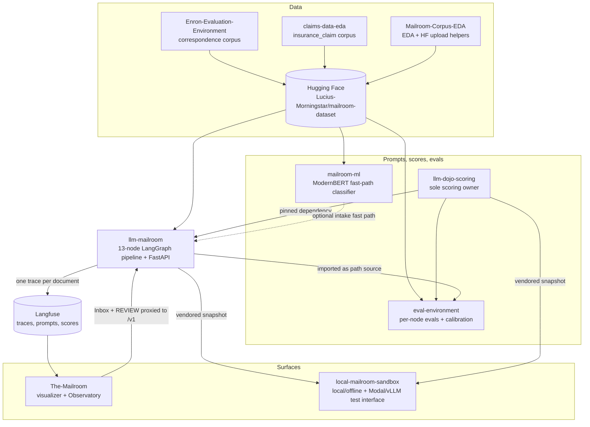
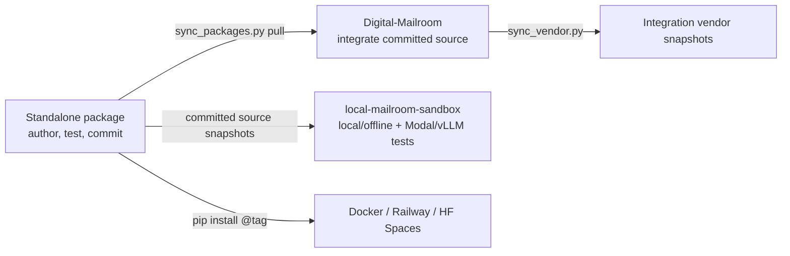

# How the constellation fits together

This page explains what flows between the repositories. For the inside of the pipeline itself (nodes, routing, thresholds), see [Pipeline architecture](../pipeline-reference-llm-mailroom/architecture.md).

## The big picture

The standalone repositories own their implementations. [Digital-Mailroom](repos/digital-mailroom.md)
imports their committed source into one workspace and refreshes vendor snapshots.
Cross-repository changes are authored and tested in each owning repository first;
the hub integrates them afterward.

## The flows, one by one

### Data: from raw corpora to a pinned dataset

1. **Corpus feeds build class-specific samples.** Enron-Evaluation-Environment turns 517K Enron emails into a stratified, de-duplicated `correspondence` sample. claims-data-eda renders CMS Medicare claim events into plain-text EOB documents with ground truth for `insurance_claim`. Contracts (CUAD), merger agreements (MAUD) and corporate records (EDGAR S-1 exhibits) come from public legal corpora.
2. **Everything is published to one dataset.** The canonical corpus is [`Lucius-Morningstar/mailroom-dataset`](https://huggingface.co/datasets/Lucius-Morningstar/mailroom-dataset): 3,302 documents, five classes, 55 class-by-subclass strata. Mailroom-Corpus-EDA profiles it (phases P0 to P6) and owns the upload helpers. GitBook embeds those figures on [Mailroom dataset](../mailroom-dataset/) ([visualizations](../mailroom-dataset/visualizations.md)).
3. **Consumers pin a revision, never a live tip.** The pipeline, eval-environment and mailroom-ml all pin the same Hub revision (`ed7576b6`, tag v9.1 at time of writing). The labels sit in a separate `ground_truth` config joined to the blind `default` config on `filename`, so a model under test never sees its answers.

Details: [Data and corpora](data-and-corpora.md). Full dataset section: [Mailroom dataset](../mailroom-dataset/).

### Prompts: from experiment to production

1. Prompt versions are tested one at a time across models and every run is logged to an append-only experiment log (historically in the standalone `llm-entity-extraction` repo, which left the core constellation in DMR-079).
2. When a prompt wins, it is **vendored** into llm-mailroom (`langchain_agents/`) along with its full version lineage, so evaluations can pin the exact version.
3. **eval-environment** holds the frozen v1 prompt lineage (`mailroom-evals-v1`) and the GEPA mutation loop that proposes new candidates; mailroom-issues keeps the frozen v1 reference copies.
4. In production, each agent's prompt is managed in Langfuse as `mailroom-<agent_name>` with a `production` label, and every LLM call links the prompt version it used.

### Scoring: one definition of "correct"

`llm-dojo-scoring` owns all metrics, scoring formulas, normalization rules, and suites. Consumers call its APIs and report its results; scoring fixes are implemented in dojo first. It scores fields by type (dates are normalized before comparison, names use Jaro-Winkler, lists use Hungarian matching, free text uses token F1) rather than exact-matching everything.

- llm-mailroom pins it as a git dependency and keeps the pin current with an auto-bump workflow (`.github/workflows/bump-dojo-scoring.yml`).
- eval-environment uses it for its experiment scoring.
- local-mailroom-sandbox carries a vendored snapshot so it works offline.

### Runtime: from document to archive

`llm-mailroom` owns the pipeline and runs one LangGraph state machine per document: intake, classify (with retry and a second-opinion reviewer), extract (with retry, judge, arbiter and boss escalation), compile report, write catalog, archive. Files move through filesystem bins (`inbox → processing → archive | review | failed`). Two auxiliary flows sit outside the graph: the free-model Gmail triage lane and the post-archive relations clerk.

`local-mailroom-sandbox` owns the local/offline harness and the Modal/vLLM
test interface. It consumes committed pipeline and dojo source rather than
forking their behavior. The-Mailroom is the shared visualizer for pipeline and
sandbox runs, using their compatible producer and trace contracts.

An optional **ModernBERT fast path** from mailroom-ml can run at intake (`MAILROOM_BERT_INTAKE`, off by default). It is fail-open: if the flag is off, the package is missing or the model errors, intake carries on with the deterministic clerk.

Full detail: [Pipeline architecture](../pipeline-reference-llm-mailroom/architecture.md) and [Agents](../agents.md).

### Observability: the trace contract

Every document produces one Langfuse trace named `document-pipeline`, with verb-first node spans (`classify-document`, `extract-fields`, ...), a session per matter (or per pilot run), and tags for environment and source.

**The-Mailroom** treats those traces as its only source of truth: nothing on its screens is invented. That creates a contract between the two repos. When the pipeline changes span names, node order, the agent roster, document classes, confidence thresholds or judge score names, The-Mailroom must update `mailroom_ui/pipeline_schema.py` and `mailroom_ui/trace_interpreter.py` in the same change window, or new spans render as "unknown".

The-Mailroom's Inbox and REVIEW desk call back into the pipeline API (`MAILROOM_PIPELINE_URL` + `MAILROOM_PIPELINE_TOKEN` + `/v1`) so operators can queue documents and resolve reviews without holding producer keys in the browser.

eval-environment deliberately does **not** trace to Langfuse; it uses Braintrust or a local Arize Phoenix sink so eval runs never mix with production traces.

### Code: standalone sources and integration hub

- Develop pipeline changes in llm-mailroom and scoring changes in dojo. Commit source-owned work before hub imports or vendor refreshes.
- Digital-Mailroom owns integration and coordination. Do not export hub patches or package trees into feeder repositories, or use hub-to-feeder development pushes.
- Hub workspace redirects resolve imported packages through `[tool.uv.sources]`; standalone published dependency pins change only through an explicit release or adoption task.
- `scripts/sync_packages.py pull` imports committed upstream source; vendor refreshes follow the same source ownership. Nested package workflows do not run inside the hub.

## Dependency summary

| Consumer | Depends on | How |
| :--- | :--- | :--- |
| llm-mailroom | llm-dojo-scoring | git pin `@db15b7c593a533bb07c388a5af74f70750769055` as of 2026-10-25; changed through explicit release adoption |
| llm-mailroom | mailroom-ml | optional, lazily imported at intake |
| eval-environment | llm-mailroom (and dojo through it) | editable path source to a sibling checkout, set in `[tool.uv.sources]` |
| local-mailroom-sandbox | llm-mailroom, llm-dojo-scoring | tracked snapshots under `vendor/` |
| The-Mailroom | llm-mailroom | Langfuse traces + HTTP API; optional `[pipeline]` extra pins a `main` commit |
