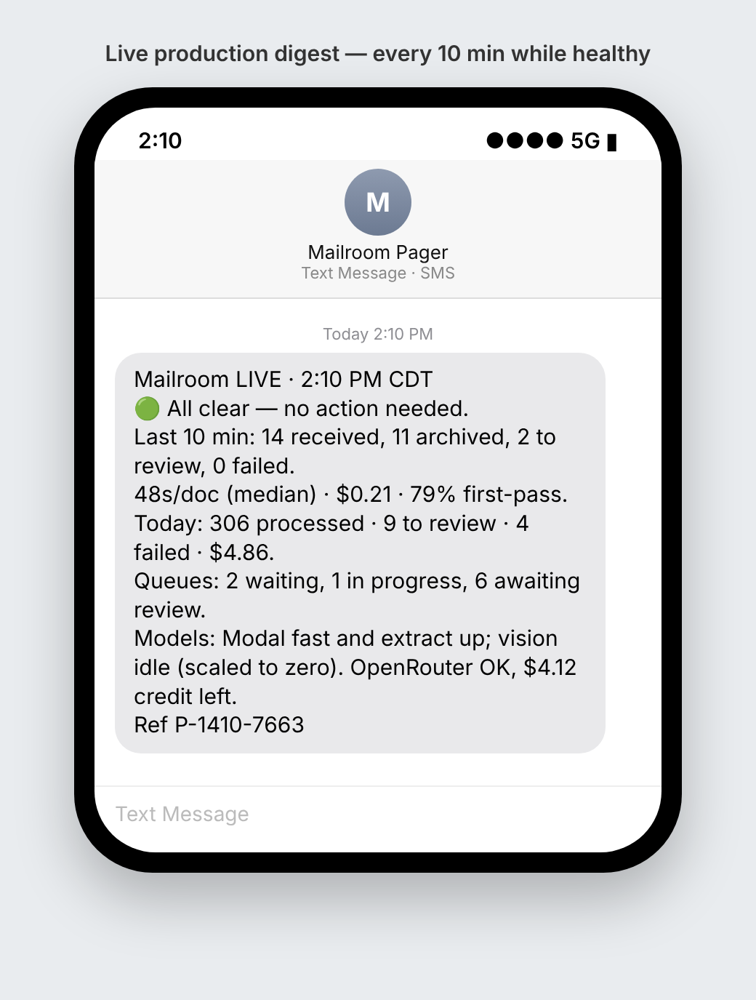
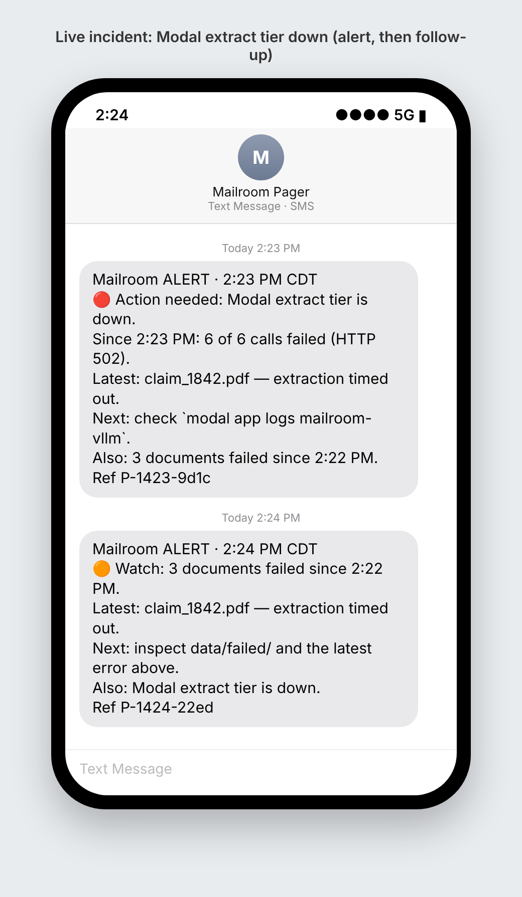
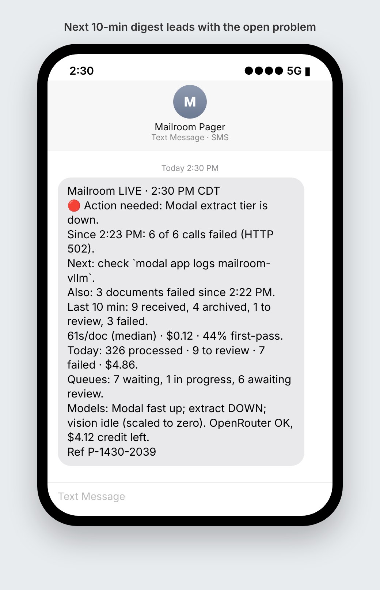
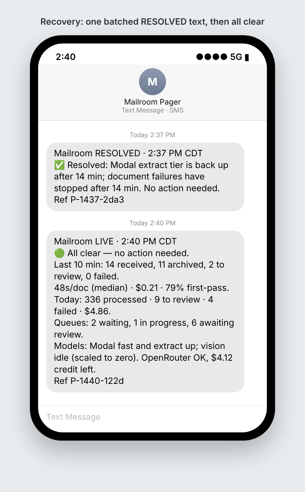

# Operator SMS pager verification

- **Date**: 2026-10-15
- **Kind**: audits (Repository audit and synthesis reports)
- **Status**: final

## Scope

The operator SMS pager (`pipeline/pager.py`, `pipeline/pager_core.py`, `pipeline/sms_notify.py`,
`llm/provider_health.py`):
- 10-minute digests during live production runs;
- 60-second scans that stay silent while healthy and text only on failures;
- resolution texts;
- the `mailroom.pager/v1` machine record;
- the `python -m pipeline.pager` CLI.

## Method

- `PYTHONPATH=src .venv/bin/python -m pytest src/tests/test_pager*.py src/tests/test_sms_notify.py src/tests/test_provider_health.py`
  runs the hermetic pager suite.
- `docs/assets/pager-evidence/simulate_live_run.py` drives the real `Pager.tick` over a scripted
  45-minute live run (2:00–2:45 PM CDT, 135 host ticks, two recipients).
  - Modal's extract tier fails with HTTP 502 from 2:23 to 2:36, and three documents fail.
  - Config resolution, scheduling, rendering, per-recipient delivery and `pager_log.jsonl` are all real.
  - Only the snapshots and the phone (a recording transport in place of Twilio) are simulated.
- `render_phone.py` + `shoot.sh` render each delivered text in a phone frame. The screenshots come from headless Chromium.

## Findings

1. The healthy scans sent nothing. During the run the pager sent 7 distinct texts and made
   14 deliveries (7 × 2 recipients). Each text appears exactly once in `pager_log.jsonl`, with masked numbers.
2. Digest at 2:10 and 2:20: 🟢 all clear, with the window, today, queues and models.
   
3. At 2:23, 🔴 ALERT "Modal extract tier is down" (6 of 6 calls failed, HTTP 502) with a next step.
   At 2:24, a 🟠 follow-up for the 3 failed documents.
   
4. The 2:30 digest leads with the open problem instead of "all clear".
   
5. At 2:37 a single batched ✅ RESOLVED text covers both recoveries. The 2:40 digest is back to 🟢.
   
6. The full thread as one phone shows it is in `05-full-incident-thread.png`. The exact bodies are in
   `simulation-transcript.txt`, and the machine-readable records are in `pager_log.jsonl`.

## Recommendations

- Before a first live run, set the Twilio credentials and send `python -m pipeline.pager test`.
- A standalone `pager preview` digest reads "All clear" even when failures fall in its window, because no
  scan has run in that process. This is a deferred minor; live digests are not affected.
